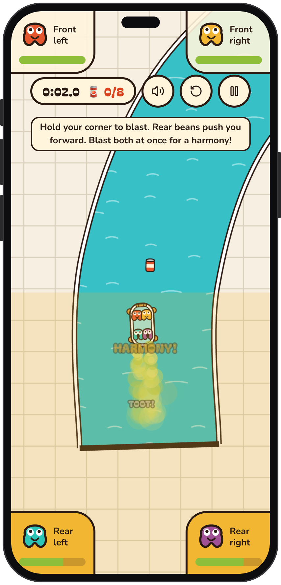

# Ba Ham Begoozim

A couch co-op browser game. Four baked beans share one clawfoot bathtub, and the
only engine on board is what the beans had for lunch. Everyone blasts from their
own corner, so steering takes teamwork.

Play it at <https://gooz.zendegi.io>.

<p align="center">
  
</p>

## Running it

```bash
bun install && bun dev
```

## Controls

| Seat        | Key | Effect                      |
| ----------- | --- | --------------------------- |
| Front left  | `Q` | Pushes back, turns left     |
| Front right | `P` | Pushes back, turns right    |
| Rear left   | `Z` | Pushes forward, turns right |
| Rear right  | `M` | Pushes forward, turns left  |

Playing solo? `←` and `→` work the rear seats and `↓` works both front seats. On
a phone each bean owns a quarter of the screen, and on a tablet a pad in its corner:
hold your corner to blast. `Esc` pauses, `R` restarts.

Blast within a blink of another bean for a **harmony**: a bigger shove, a little
gas back, and a chord.

## Playing online

Choose **Make a room** in the menu and send your friends the link, or the six-digit
code. Everyone picks the beans they want, and one person can work several. Bots can
fill the seats nobody took. If someone's connection drops, their seat waits 15 seconds
for them, then a bot or a teammate can have it, and reloading the page gets it back
if nobody has.

Online play needs a small backend, and stays hidden until one is set up. See
[workers/rooms](workers/rooms/README.md) for running it locally and deploying it.

## Languages

The game follows the browser's language, and the menu has a switcher that remembers
the choice. In Persian (فارسی) the layout runs right to left, but seats and keys stay
in the same physical place: the labels `ض`, `ح`, `ظ` and `پ` are the same keys as `Q`,
`P`, `Z` and `M` on the standard Persian layout (ISIRI 9147).

## How it's built

- `src/features/game/engine` — deterministic, DOM-free simulation and levels.
- `src/features/game/render` — Canvas 2D scene, particles and the WebAudio synth.
- `src/features/game/components` — menu, HUD and the game loop.
- `src/features/online` — online play: the room's authoritative game, the messages
  between it and each player, and each player's connection and prediction.
- `workers/rooms` — the Cloudflare Durable Object that hosts a room.
- `src/features/game/i18n` — English and Persian text, language choice and number
  formatting. A new level needs an entry under its id in both `en.ts` and `fa.ts`,
  and the tests fail until it has one.

`bun test` runs a bot through every level, so a course that can't be finished
fails the suite. The same bot drives the demo behind the menu.

## Feedback

The speech bubble in the menu opens a popup that emails what players write, through
`src/app/api/feedback/route.ts` and [Resend](https://resend.com). The Vercel
integration sets the Resend variables; the sending domain has to be verified in
Resend before any email goes out.

| Variable              | Value                                     |
| --------------------- | ----------------------------------------- |
| `RESEND_API_KEY`      | Resend API key                            |
| `RESEND_EMAIL_DOMAIN` | Verified sending domain                   |
| `FEEDBACK_EMAIL`      | Address that receives the players' emails |

## Analytics

Pageviews and game events (`level_started`, `level_finished`, `level_abandoned`,
`card_shared`) go to [PostHog](https://posthog.com) when these variables are set. The Vercel
integration sets them for Preview and Production, so local dev sends nothing.
PostHog is used for analytics only: flags, replay, surveys and the rest stay off.

| Variable                            | Value                                                  |
| ----------------------------------- | ------------------------------------------------------ |
| `NEXT_PUBLIC_POSTHOG_PROJECT_TOKEN` | Project token                                          |
| `NEXT_PUBLIC_POSTHOG_HOST`          | Ingestion host, defaults to `https://us.i.posthog.com` |

The game runs PostHog in cookieless mode, so **turn on cookieless server hash mode
in the PostHog project settings**. PostHog drops the events otherwise.
